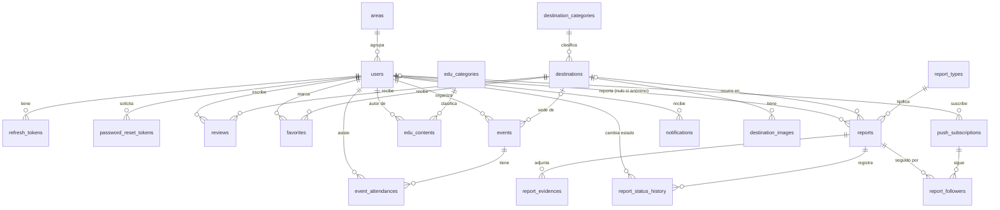

# TuDestino — Fuente única de verdad

> Este archivo es la referencia canónica del proyecto. Si otro documento o una conversación lo contradice, gana este archivo. Si hay que cambiar una decisión, se edita aquí primero (y se registra en la sección 21).
> Estado: **implementación F0–F9 completada y revisión final de interfaz/documentación en curso** (proyecto desde cero, sin clonar `Manuel-Avila/tu-destino`). Última revisión: 2026-11-02.

---

## 1. Propósito y precedencia de fuentes

TuDestino es el proyecto final de **Aplicaciones Web Progresivas (PWA)**. Debe cumplir la rúbrica del PDF de PWA por encima de cualquier otra cosa.

**Orden de precedencia cuando hay conflicto:**

1. `Proyecto Final - Aplicaciones Web Progresivas.pdf` (rúbrica; manda siempre).
2. Decisiones del equipo registradas en este archivo (sección 21).
3. `Monica.pdf` — **solo** requisitos (RF, RNF, historias de usuario).
4. `tics.pdf` — problema, objetivos, usuarios y stack sugerido.

**Excluido explícitamente:**

| Elemento | Motivo |
|---|---|
| "Tecnología emergente" de `tics.pdf` (A-Frame / 360°) | Indicación del equipo |
| Modelo entidad-relación de `tics.pdf` y `Monica.pdf` | Mal planteado; se reemplaza por el de la sección 10 |
| Marco teórico, mockups y repositorio previo de `Monica.pdf` | Solo se toman los requisitos |
| Reservas, pagos y chat | Fuera de alcance (no es un marketplace transaccional) |

Los PDFs fuente viven en la raíz del proyecto (moverlos a `docs/fuentes/` cuando se inicialice git).

---

## 2. Resumen del producto

**Idea:** un "Airbnb de sitios turísticos" de Baja California Sur (BCS) con enfoque de **turismo responsable**. Las personas descubren sitios turísticos, los califican, los guardan como favoritos, se enteran de eventos (limpiezas de playa, jornadas) y pueden enviar **reportes ciudadanos** sobre fauna marina (opcionalmente anónimos).

**Problema (tics.pdf):** presión turística sobre los ecosistemas, poca participación ciudadana e información dispersa.

**Objetivo general:** plataforma web que integre información de destinos, educación ambiental, eventos y reportes ciudadanos para impulsar un turismo sostenible.

**ODS:** 14 (vida submarina), 16 (instituciones sólidas), 17 (alianzas).

**Glosario**

| Término | Significado |
|---|---|
| Destino / sitio | Lugar turístico publicable (playa, ANP, mirador, sitio cultural) |
| ANP | Área Natural Protegida |
| Reporte | Aviso ciudadano (tortuga anidando, animal varado, contaminación, actividad sospechosa; «Otro» se agregó como opción adicional) |
| Folio | Identificador legible de un reporte, p. ej. `TD-2026-000123` |
| Código de seguimiento | Secreto que acompaña al folio para consultar un reporte anónimo |
| Autoridad | Persona de una dependencia ambiental que gestiona reportes y contenido |

---

## 3. Alcance de la versión 1

**Incluye:** catálogo de destinos con búsqueda y filtros, reseñas, favoritos, mapa, eventos, educación ambiental, reportes (con fotos, geolocalización, anonimato, folio y seguimiento), panel de autoridad/administración, notificaciones, uso sin conexión parcial e instalación como app.

**No incluye (se documenta en "características no implementadas" del documento técnico):** reservas, pagos, chat, inicio de sesión con redes sociales (OAuth), A-Frame/360°, Wake Lock.

---

## 4. Roles y permisos

Cuatro roles: `visitor` (sin cuenta), `user` (turista o ciudadano), `authority` (gestiona reportes y contenido de su área), `admin` (todo, incluidos usuarios).

| Acción | visitor | user | authority | admin |
|---|:-:|:-:|:-:|:-:|
| Ver destinos, eventos y contenido educativo | ✅ | ✅ | ✅ | ✅ |
| Buscar y filtrar | ✅ | ✅ | ✅ | ✅ |
| Crear reporte (anónimo o con cuenta) | ✅ | ✅ | ✅ | ✅ |
| Consultar un reporte por folio + código | ✅ | ✅ | ✅ | ✅ |
| Favoritos, reseñas, asistir a eventos, perfil | ❌ | ✅ | ✅ | ✅ |
| Proponer eventos (queda `pending`) | ❌ | ✅ | ✅ | ✅ |
| Aprobar/editar/cancelar eventos, CRUD de destinos y educación | ❌ | ❌ | ✅ (su área) | ✅ |
| Gestionar reportes y cambiar su estado | ❌ | ❌ | ✅ | ✅ |
| Gestionar usuarios, roles y áreas | ❌ | ❌ | ❌ | ✅ |

---

## 5. Requisitos funcionales

Fuente: `Monica.pdf` págs. 9–11, salvo los marcados como *nuevo*.

| ID | Requisito | Prioridad |
|---|---|---|
| RF01 | Consultar destinos (descripción, ubicación, calificación) | Alta |
| RF02 | Consultar playas y ANP | Alta |
| RF03 | Consultar educación ambiental | Media |
| RF04 | Módulo de eventos (limpiezas, jornadas) en lista y calendario | Alta |
| RF05 | Ciudadanos y turistas pueden crear reportes | Alta |
| RF06 | Tipos de reporte: tortuga anidando, animal varado, contaminación, actividad sospechosa; «Otro» como opción adicional | Alta |
| RF07 | Adjuntar fotos de evidencia | Alta |
| RF08 | Incluir ubicación aproximada | Alta |
| RF09 | Reporte anónimo | Alta |
| RF10 | La autoridad consulta reportes | Alta |
| RF11 | La autoridad revisa evidencias | Alta |
| RF12 | La autoridad cambia el estado del reporte | Alta |
| RF13 | Administrar destinos | Alta |
| RF14 | Administrar eventos | Alta |
| RF15 | Administrar contenido educativo | Media |
| RF16 | Gestión de usuarios y permisos | Media |
| RF17 | Ver y editar perfil | Media |
| RF18 | Búsqueda | Alta |
| RF19 | *Nuevo.* Marcar destinos como favoritos ("likes") y ver "Mis favoritos" | Alta |
| RF20 | *Nuevo.* Organizar eventos (ver decisión D-01) | Alta |
| RF21 | *Nuevo.* Compartir destinos y eventos (Web Share) | Media |
| RF22 | *Nuevo.* Seguimiento de un reporte por folio y avisos de cambio de estado | Media |
| RF23 | *Nuevo.* Crear reportes sin conexión con envío diferido | Alta |

---

## 6. Requisitos no funcionales

Fuente: `Monica.pdf` págs. 11–12. Se añaden métricas verificables.

| ID | Requisito | Métrica / criterio |
|---|---|---|
| RNF01 | Disponibilidad | App usable sin conexión (parcial); API con healthcheck |
| RNF02 | Usabilidad | Flujos principales en ≤ 3 pasos; estados de carga, vacío, error y offline en cada pantalla |
| RNF03 | No exponer datos sensibles de reportes | Ver sección 13; mapa público filtrado |
| RNF04 | Respuesta ≤ 4 s | p95 de la API < 4 s; LCP < 2.5 s en 4G simulada |
| RNF05 | Protección y control de acceso | JWT + RBAC en servidor; HTTPS |
| RNF06 | Legibilidad y accesibilidad | Lighthouse Accessibility ≥ 90; contraste AA; navegación por teclado |
| RNF07 | Integridad de los reportes | Historial de estados inmutable; sin edición del contenido original |
| RNF08 | Responsive | Mobile first desde 360 px |
| RNF09 | Diseño modular (el PDF dice "molecular"; se interpreta como errata) | Código organizado por features y componentes reutilizables |

---

## 7. Historias de usuario (resumen de criterios)

**Turista / ciudadano**

| ID | Historia | Criterios clave |
|---|---|---|
| HU-T01 | Registro | Correo único; contraseña ≥ 8 con números y símbolos. "Registro con redes" queda fuera de v1 |
| HU-T02 | Login | Mensaje de error genérico (no revela si el correo existe) |
| HU-T03 | Recuperar contraseña | Token de un solo uso, vence en 15–30 min; respuesta idéntica exista o no el correo |
| HU-T04 | Logout | Invalida el token en frontend y backend |
| HU-T05 | Ver destinos | Lista con promedio, detalle con reseñas, filtro por categoría |
| HU-T06 | Ver eventos | Vista lista y calendario |
| HU-T07 | Asistir a eventos | Botón "Asistiré"; sección "Mis eventos" |
| HU-T08 | Educación ambiental | Artículos y videos con búsqueda y filtros |
| HU-T09 | Crear reporte | Tipo, descripción, varias fotos, geolocalización; anónimo sin vincular usuario; genera folio |
| HU-T10 | Perfil | "Mis eventos", "Mis reseñas", "Mis favoritos" |
| HU-T11 | Editar perfil | Datos y avatar |
| HU-T12 | Reseñar | 1–5 estrellas, publicación inmediata, autor oculto en público |
| HU-T13 | Mapa | Pines distintos para destinos y reportes, popup y enlace al detalle |

> El PDF nombra la última como "HU-T013"; aquí se normaliza a HU-T13.

**Autoridad / administrador**

| ID | Historia | Criterios clave |
|---|---|---|
| HU-A01 | Login al panel | Solo roles `authority` y `admin` |
| HU-A02 | Tabla de reportes | Filtros por estado (pendiente, en revisión, resuelto, descartado) y tipo; búsqueda por folio |
| HU-A03 | Detalle de reporte | Galería de evidencias e historial |
| HU-A04 | Cambiar estado | Nota obligatoria; historial inmutable con fecha y autor; consulta por folio |
| HU-A05 | CRUD de destinos | Borrado lógico, imágenes, categoría, coordenadas |
| HU-A06 | CRUD de eventos | No se permiten fechas pasadas al crear |
| HU-A07 | CRUD de contenido educativo | Se puede despublicar |
| HU-A08 | Gestión de usuarios | Alta de administradores, revocar acceso, roles "según el área" |

---

## 8. Características PWA

### 8.1 Obligatorias (todas se deben cumplir)

| ID | Característica | Cómo se cumple |
|---|---|---|
| PWA-01 | Responsive / Mobile First | CSS mobile first desde 360 px; sin scroll horizontal |
| PWA-02 | SPA sin recargas | React + React Router |
| PWA-03 | JavaScript modular | Módulos ES por feature (sección 9.3) |
| PWA-04 | Fetch API con manejo de errores | Cliente único `api/client.js`: timeout, errores tipados, estados offline/error en UI |
| PWA-05 | Almacenamiento local | IndexedDB (contenido, favoritos, cola de reportes), LocalStorage (tema, aviso de instalación), SessionStorage (borradores y filtros) |
| PWA-06 | Service Worker | `src/sw.js` escrito a mano (ver ADR-02) |
| PWA-07 | Cache API con ≥ 1 estrategia | Tabla de la sección 12 |
| PWA-08 | Funcionamiento offline (al menos parcial) | Navegar destinos, eventos y educación cacheados; crear reportes y propuestas de eventos en cola |
| PWA-09 | Manifest con nombre e íconos | `name`, `short_name`, íconos 192/512 y maskable, `theme_color`, `start_url`, `display: standalone` |
| PWA-10 | Instalable | `beforeinstallprompt` con botón propio; verificado en DevTools > Application |
| PWA-11 | HTTPS | Despliegue con certificado válido |
| PWA-12 | Rendimiento auditado con Lighthouse | Reportes guardados por release en `docs/evidencias/` |

> Lighthouse 12+ ya no tiene la categoría "PWA". La auditoría se hace con Performance, Accessibility, Best Practices y SEO; la instalabilidad se demuestra con DevTools > Application (Manifest y Service Workers).

### 8.2 Adicionales (la rúbrica exige ≥ 2; se implementan 4, cada una con función real)

| ID | API | Función real | Beneficio para el usuario |
|---|---|---|---|
| PWA-13 | Background Sync | Cola de reportes creados sin señal; se envían al volver la conexión. `client_uuid` evita duplicados. Fallback sin soporte (Safari): evento `online` y reintento al abrir la app | Playas y zonas protegidas casi nunca tienen cobertura |
| PWA-14 | Geolocation | Captura de coordenadas del reporte, «Mi ubicación» en el mapa y selector en propuestas de eventos | Reporte preciso sin escribir coordenadas |
| PWA-15 | Web Share | Compartir eventos (tarjeta y detalle); fallback: copiar enlace. El botón de destinos se retiró en la revisión final de interfaz | Difunde campañas de limpieza (ODS 17) |
| PWA-16 | Push + Badging | Aviso cuando cambia el estado de un reporte y recordatorio de eventos; el badge muestra notificaciones sin leer | Seguimiento sin abrir la app. En iOS solo funciona con la PWA instalada (se documenta) |

Si hay que recortar alcance: PWA-13 y PWA-14 bastan para la rúbrica; PWA-16 es la más costosa.

### 8.3 Uso de IA (exigido por la rúbrica)

Cada integrante debe poder explicar y modificar todo el código. Se registra cada uso de IA en `docs/uso-ia.md` (fecha, herramienta, qué se generó, quién lo revisó).

---

## 9. Arquitectura y stack

### 9.1 Stack

| Capa | Tecnología |
|---|---|
| Frontend | React 18, Vite, React Router, CSS mobile first, `idb` (IndexedDB) |
| PWA | `vite-plugin-pwa` en modo `injectManifest`; Service Worker propio con `workbox-precaching`, `-routing`, `-strategies`, `-background-sync` |
| Backend | Node 20, Express, API REST en `/api/v1` |
| Validación y seguridad | zod, helmet, express-rate-limit, CORS restrictivo, bcrypt o argon2 |
| Datos | PostgreSQL 16 + PostGIS |
| Archivos | Cloudinary (con `f_auto,q_auto`) |
| Mapas | Leaflet + OpenStreetMap (ADR-09) |
| Correo | nodemailer + proveedor SMTP (Resend, Brevo o Mailtrap en desarrollo) |
| Push | `web-push` (VAPID) |
| Entorno local | Docker Compose (db, api, web) |
| Calidad | ESLint, Prettier, Vitest/Jest, Lighthouse |

### 9.2 Despliegue (HTTPS)

Frontend estático en Vercel, Netlify o Cloudflare Pages; API en Render, Railway o Fly; base de datos en Neon o Supabase (ambos con PostGIS). **Tradeoff real:** los planes gratuitos "duermen" la API y el primer request puede superar los 4 s (RNF04); se mitiga con *stale-while-revalidate* en el Service Worker.

### 9.3 Estructura del repositorio (guía; se ajusta al crear el proyecto)

```
TuDestino/
├─ CLAUDE.md
├─ compose.yaml
├─ docs/
│  ├─ fuentes/            # PDFs originales
│  ├─ evidencias/         # capturas y reportes de Lighthouse
│  ├─ uso-ia.md
│  └─ documento-tecnico.md
├─ backend/
│  ├─ src/{config,controllers,middleware,models,routes,services,utils}
│  └─ migrations/
└─ frontend/
   ├─ public/             # manifest, íconos, offline.html
   └─ src/
      ├─ sw.js
      ├─ api/client.js
      ├─ storage/         # idb, localStorage, sessionStorage
      ├─ features/{destinations,events,education,reports,auth,profile,admin,map}
      └─ shared/          # componentes, hooks, utilidades
```

---

## 10. Modelo de datos (reemplaza al E-R anterior)

Convenciones: PK `uuid` en entidades públicas y `bigserial` en catálogos; `created_at` y `updated_at` en todas las tablas; borrado lógico con `deleted_at` donde se pide.



### 10.1 Entidades

**Identidad y acceso**

| Tabla | Campos principales |
|---|---|
| `areas` | id, name (p. ej. PROFEPA, CONANP, municipio) |
| `users` | id, full_name, email (citext, único), password_hash, avatar_url, role (`user`/`authority`/`admin`), area_id (nulo), is_active, last_login_at |
| `refresh_tokens` | id, user_id, token_hash, expires_at, revoked_at, user_agent (HU-T04) |
| `password_reset_tokens` | id, user_id, token_hash, expires_at, used_at (HU-T03) |

**Catálogo turístico**

| Tabla | Campos principales |
|---|---|
| `destination_categories` | id, name, slug (playa, ANP, mirador, sitio cultural…) |
| `destinations` | id, name, slug, summary, description, category_id, `location geography(Point,4326)`, municipality, regulations, is_protected_area, status (`draft`/`pending`/`published`), created_by, avg_rating, reviews_count, favorites_count (desnormalizados por RNF04), deleted_at |
| `destination_images` | id, destination_id, url, cloudinary_public_id, alt_text, position |
| `reviews` | id, destination_id, user_id, rating (CHECK 1–5), comment. UNIQUE(destination_id, user_id) |
| `favorites` | PK (user_id, destination_id), created_at |

**Eventos**

| Tabla | Campos principales |
|---|---|
| `events` | id, title, description, starts_at, ends_at (CHECK ≥ starts_at), location_name, `location geography` (nulo), destination_id (nulo), image_url, capacity (nulo), organizer_id, status (`pending`/`published`/`cancelled`/`rejected`), deleted_at |
| `event_attendances` | PK (user_id, event_id), created_at |

**Educación ambiental**

| Tabla | Campos principales |
|---|---|
| `edu_categories` | id, name, slug |
| `edu_contents` | id, title, slug, type (`article`/`video`/`link`), body, media_url, cover_url, category_id, author_id, is_published, published_at, deleted_at |

**Reportes ciudadanos**

| Tabla | Campos principales |
|---|---|
| `report_types` | id, name, slug, is_sensitive |
| `reports` | id, folio (único), type_id, description, `location geography(Point)`, location_accuracy_m, destination_id (nulo), occurred_at, status (`pending`/`in_review`/`resolved`/`dismissed`), **reporter_id (NULL si es anónimo)**, tracking_code_hash, client_uuid (único; idempotencia de Background Sync), created_at. **No se guardan IP ni user-agent** |
| `report_evidences` | id, report_id, url, cloudinary_public_id, mime_type (fotos sin EXIF) |
| `report_status_history` | id, report_id, from_status, to_status, note (NOT NULL), changed_by, created_at. **Solo inserciones**: un trigger rechaza UPDATE y DELETE (RNF07) |

**Notificaciones**

| Tabla | Campos principales |
|---|---|
| `push_subscriptions` | id, user_id (nulo), endpoint (único), p256dh, auth |
| `report_followers` | PK (report_id, subscription_id). Avisa a un denunciante anónimo sin vincular su identidad, solo el dispositivo |
| `notifications` | id, user_id, type, title, body, url, read_at (alimenta el Badging API) |

### 10.2 Reglas de integridad e índices

- GIST en todas las columnas `location`.
- Índices en `reports(status, type_id)` y `reports(folio)`.
- Búsqueda de texto completo (`tsvector` en español) sobre `destinations` y `edu_contents` (RF18).
- Un reporte anónimo **nunca** tiene `reporter_id`; el seguimiento se hace con folio + código.
- `reviews`: se guarda `user_id`, pero la API pública jamás devuelve al autor.

---

## 11. API REST

Base: `/api/v1`. Errores con formato uniforme `{ "error": { "code": "...", "message": "..." } }`. Validación de entrada con zod en cada endpoint.

| Recurso | Métodos | Acceso |
|---|---|---|
| `/auth` (register, login, refresh, logout, forgot, reset) | POST | Público |
| `/destinations`, `/destinations/:id` | GET | Público |
| `/destinations` | POST, PATCH, DELETE | authority (su área), admin |
| `/destinations/:id/reviews` | GET / POST | Público / user |
| `/me/favorites` | GET, PUT, DELETE | user |
| `/events`, `/events/:id` | GET | Público |
| `/events` | POST | user (queda `pending`), authority, admin |
| `/events/:id` | PATCH, DELETE | authority (su área), admin |
| `/events/:id/attendance` | PUT, DELETE | user |
| `/edu-contents`, `/edu-categories` | GET | Público |
| `/edu-contents` | POST, PATCH, DELETE | authority, admin |
| `/reports` | POST | Público (idempotente por `client_uuid`) |
| `/reports/track` | POST (folio + código) | Público |
| `/reports` y `/reports/:id` | GET | authority, admin |
| `/reports/:id/status` | PATCH (nota obligatoria) | authority, admin |
| `/map/pins` | GET | Público (reportes filtrados, ver sección 13) |
| `/me` | GET, PATCH | user |
| `/push/subscriptions` | POST, DELETE | Público / user |
| `/admin/users` | GET, POST, PATCH | admin |

---

## 12. Estrategia offline y de caché

| Recurso | Estrategia |
|---|---|
| App shell (HTML, JS, CSS, íconos) | Precache versionado por hash |
| Navegación | Fallback a `index.html`; `offline.html` si no hay shell |
| `GET` de destinos, eventos, contenido educativo y categorías | Stale-while-revalidate + espejo en IndexedDB para buscar y filtrar sin conexión |
| Frescura tras escrituras | `catalogFreshness.js` guarda una revisión y las lecturas públicas añaden `_r` para saltar la copia vieja del navegador y del service worker; se marca al reseñar y al crear/editar/eliminar/moderar desde el panel |
| Imágenes de Cloudinary | Cache-first con expiración (≈150 entradas, 30 días) |
| Autenticación, panel de administración, `POST`/`PATCH`/`DELETE` | Network-only |
| `POST /reports` | Network-only + cola de Background Sync + *outbox* en IndexedDB visible en la interfaz |
| `POST /events` (propuesta) | Network-only desde la página + store `proposals` en IndexedDB; sin conexión se guarda y se envía al volver la red, al abrir la app o al reenfocar la pestaña. El service worker no la procesa porque requiere sesión |
| Tiles de mapa | `CacheFirst` para las teselas ya visitadas de OpenStreetMap (máx. 300, 7 días). Sin teselas, el mapa pasa a un fondo neutro y la lista equivalente sigue disponible con los destinos guardados en IndexedDB |

**Almacenamiento local:** LocalStorage (tema, aviso de instalación); SessionStorage (borradores de formularios, filtros activos); IndexedDB (contenido cacheado, favoritos, outbox).

---

## 13. Seguridad y privacidad

| Tema | Regla |
|---|---|
| Anonimato | Reporte anónimo ⇒ `reporter_id = NULL`, sin IP ni user-agent. Seguimiento con folio + código (solo se guarda su hash) |
| Fotos | Se eliminan los metadatos EXIF (GPS, dispositivo) antes de guardarlas |
| Mapa público | Solo reportes resueltos o validados, ubicación redondeada (~500 m), sin tipos con `is_sensitive`. El mapa completo es solo para autoridad |
| Autenticación | Access JWT de vida corta (en memoria) + refresh token en cookie `httpOnly; Secure; SameSite` con rotación y revocación en servidor |
| Contraseñas | bcrypt o argon2; mensajes de error genéricos |
| Abuso | Rate limiting en login, recuperación y reportes |
| Transporte | HTTPS obligatorio; helmet y CORS restrictivo |
| Secretos | Solo en variables de entorno; `.env` en `.gitignore` y variables documentadas en `README.md` (no hay `.env.example` versionado) |
| Autorización | RBAC verificado en el servidor, nunca solo en la interfaz |

---

## 14. Convenciones de código

- JavaScript con módulos ES; un módulo por feature; componentes pequeños y reutilizables.
- Identificadores de código y de base de datos en **inglés**; interfaz y documentación en **español neutro**.
- ESLint + Prettier obligatorios antes de cada commit.
- Sin lógica de negocio en controladores: va en `services/`.
- Todo `fetch` pasa por `api/client.js`.
- Cada pantalla maneja cuatro estados: cargando, vacío, error y sin conexión.

---

## 15. Flujo de Git

- Repositorio nuevo (`git init`) con remoto en GitHub. El primer commit es este archivo.
- **Conventional Commits** en español o inglés, siempre consistentes: `feat(pwa): agregar service worker`, `fix(reports): evitar duplicados`, `docs: ...`.
- Ramas por feature (`feat/...`, `fix/...`) y *merge* a `main` por pull request.
- **Un commit (o grupo pequeño) por cada característica PWA** para que la evolución sea visible; la rúbrica evalúa commits progresivos y significativos.
- Prohibido añadir `Co-Authored-By` o atribución de IA en los commits (regla del equipo). El uso de IA se declara en `docs/uso-ia.md`.

---

## 16. Definition of Done y pruebas

Una funcionalidad está terminada cuando:

- [ ] Cumple sus criterios de aceptación (sección 7) y está trazada en la sección 20.
- [ ] Funciona en 360 px y en escritorio.
- [ ] Maneja estados de carga, vacío, error y sin conexión.
- [ ] Sin errores en consola.
- [ ] Tiene pruebas (unitarias en servicios; integración en endpoints críticos; manual en el flujo offline).
- [ ] Lint y formato pasan.
- [ ] Hay evidencia (captura o reporte Lighthouse) en `docs/evidencias/`.

---

## 17. Despliegue, entorno y comandos

> Se completa cuando exista el código. Plantilla:

| Tarea | Comando |
|---|---|
| Levantar entorno local | `docker compose up` |
| Migraciones | `npm run migrate` (backend) |
| Desarrollo frontend | `npm run dev` (frontend) |
| Pruebas | `npm test` |
| Lint / formato | `npm run lint` / `npm run format` |
| Build | `npm run build` |

Variables de entorno previstas: `DATABASE_URL`, `JWT_SECRET`, `JWT_REFRESH_SECRET`, `CLOUDINARY_URL`, `VAPID_PUBLIC_KEY`, `VAPID_PRIVATE_KEY`, `SMTP_URL`, `MAPS_API_KEY`, `CLIENT_ORIGIN`.

---

## 18. Registro de uso de IA

`docs/uso-ia.md`, una fila por uso: fecha · herramienta · qué se generó · archivos · quién lo revisó y entendió. Cada integrante debe poder explicar y modificar cualquier parte del código.

---

## 19. Entregables (checklist)

1. [ ] Repositorio con commits progresivos.
2. [ ] App funcional, responsive, desplegada por HTTPS e instalable.
3. [ ] **Documento técnico** (`docs/documento-tecnico.md`): descripción; tecnologías; características PWA obligatorias y adicionales (dónde, cómo y por qué); características no implementadas y razón; pruebas; evidencias (capturas, Lighthouse, código); uso de IA.
4. [ ] **Presentación** con demo offline, demo de instalación y demo de las características adicionales.

Guion de demo sugerido: instalar la app → activar modo avión y navegar contenido cacheado → crear un reporte sin conexión → recuperar conexión y ver la sincronización → compartir un evento → recibir un aviso push por cambio de estado.

---

## 20. Matriz de trazabilidad

| Ítem de la rúbrica | Implementación (módulo) | Cubre | Prueba | Evidencia | Estado |
|---|---|---|---|---|---|
| PWA-01 Responsive | CSS global + features | RNF08, RNF02, RNF06 | Manual 360 px / escritorio | Capturas | ⬜ |
| PWA-02 SPA | React Router | RNF02, RNF04 | Navegación sin recarga | — | ⬜ |
| PWA-03 JS modular | `features/*` | RNF09 | Revisión de estructura | — | ⬜ |
| PWA-04 Fetch + errores | `api/client.js` | RF01–RF18, RNF01 | Unitaria + simulación de fallo | — | ⬜ |
| PWA-05 Almacenamiento local | `storage/` | RF19, RF23, HU-T09 | Manual | Capturas DevTools | ⬜ |
| PWA-06 Service Worker | `sw.js` | RNF01 | DevTools > Application | Captura | ⬜ |
| PWA-07 Cache API | Sección 12 | RNF01, RNF04 | DevTools > Cache Storage | Captura | ⬜ |
| PWA-08 Offline parcial | Contenido cacheado + outbox | RF01–RF04, RF23 | Modo avión | Video/capturas | ⬜ |
| PWA-09 Manifest | `public/manifest.webmanifest` | — | DevTools > Manifest | Captura | ⬜ |
| PWA-10 Instalable | `beforeinstallprompt` | — | Instalación real | Captura | ⬜ |
| PWA-11 HTTPS | Despliegue | RNF05 | Navegador | Captura | ⬜ |
| PWA-12 Lighthouse | Optimización de assets | RNF04, RNF06 | Lighthouse | Reporte por release | ⬜ |
| PWA-13 Background Sync | Cola de reportes | RF05–RF09, RF23, HU-T09 | Modo avión + reconexión | Video | ⬜ |
| PWA-14 Geolocation | Formulario de reporte, mapa y propuesta de eventos | RF08, HU-T13 | Manual | Captura | ⬜ |
| PWA-15 Web Share | Tarjeta y detalle de evento (el destino ya no muestra el botón) | RF04, RF21 | Manual en móvil | Captura | ⬜ |
| PWA-16 Push + Badging | Notificaciones de reporte y eventos | RF12, RF22, HU-A04, HU-T07 | Manual | Captura | ⬜ |
| No implementadas | A-Frame, OAuth, Wake Lock, reservas/pagos | — | — | Texto en el documento técnico | ⬜ |

**Matriz inversa (RF → pantalla → endpoint):** se mantiene en `docs/trazabilidad-rf.md` y debe cubrir RF01–RF23 antes de la entrega. Ese documento conserva el detalle de implementación y pruebas por fase; esta matriz se actualiza al cierre de la entrega.

---

## 21. Decisiones y preguntas abiertas

### Decisiones tomadas

| ID | Decisión | Motivo |
|---|---|---|
| ADR-01 | Proyecto desde cero; no se clona `Manuel-Avila/tu-destino` | Decisión del equipo |
| ADR-02 | Service Worker escrito a mano con Workbox como librería (`injectManifest`) | La rúbrica exige poder explicar el código |
| ADR-03 | Anonimato real: `reporter_id` nulo, sin IP, EXIF eliminado, seguimiento por folio + código | Resuelve el conflicto entre HU-T09 ("sin vincular usuario") y RF09 |
| ADR-04 | Mapa público limitado a reportes validados y con ubicación redondeada | Proteger nidos y denunciantes (RNF03) |
| ADR-05 | Inicio de sesión solo con correo y contraseña; OAuth fuera de v1 | Alcance; se documenta como no implementado |
| ADR-06 | Cuatro roles: `visitor`, `user`, `authority`, `admin` | Los PDFs usan nombres distintos sin unificar |
| ADR-07 | Auditoría Lighthouse sin categoría PWA | Lighthouse 12+ la eliminó |
| ADR-08 | `CLAUDE.md` en español neutro; código e identificadores en inglés | Documentos fuente en español |
| ADR-09 | Leaflet + OpenStreetMap en lugar de Google Maps | Sin API key ni facturación; permite cachear teselas visitadas y el modo sin conexión. Cierra D-03 |
| ADR-10 | Interfaz final: tema azul, Inicio y Explorar comparten catálogo, sin «Cerca de mí» en el catálogo ni botón de compartir en destinos; valoraciones solo reales | Simplificar la navegación y no mostrar datos simulados |
| ADR-11 | Imágenes públicas en Cloudinary (`type: upload`) y evidencias privadas (`type: authenticated`); credenciales en el `.env` de la raíz, nunca en git | Las fotos de perfil, destinos, eventos y educación deben renderizarse directo; las evidencias de reportes siguen protegidas |
| ADR-12 | El service worker solo registra rutas `GET`; los `POST`/`PUT`/`PATCH`/`DELETE` no se interceptan | Safari 26.x en iOS pierde el cuerpo de un `POST` multipart cuando el worker lo reenvía con `fetch(request)`, lo que rompía la subida de imágenes desde iPhone |
| ADR-13 | Un solo `ImagePicker` para todos los formularios, con subida inmediata opcional; las propuestas de eventos usan un store `proposals` aparte y las entrega solo la página | Evita reimplementar el selector por pantalla y permite guardar propuestas sin red sin mezclarlas con el outbox de reportes ni enviarlas sin sesión |

### Decisiones abiertas (valor por defecto aplicado; el equipo puede cambiarlo)

| ID | Pregunta | Valor por defecto |
|---|---|---|
| D-01 | ¿Quién organiza eventos y publica sitios? El enfoque "Airbnb" sugiere que los usuarios, pero los PDFs (RF14, HU-A06) dicen que solo la autoridad | Los usuarios **proponen** eventos (`pending`) y la autoridad los aprueba. Sin reservas ni pagos |
| D-02 | ¿La inscripción a eventos es solo "Asistiré" o un registro con cupo y cancelación? | "Asistiré" simple (HU-T07) |
